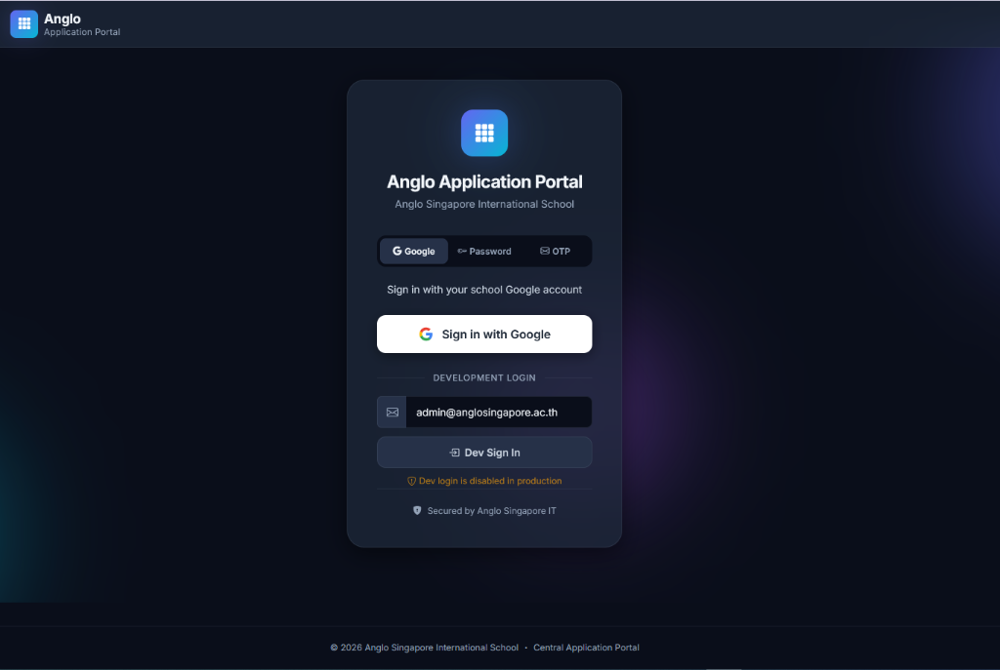
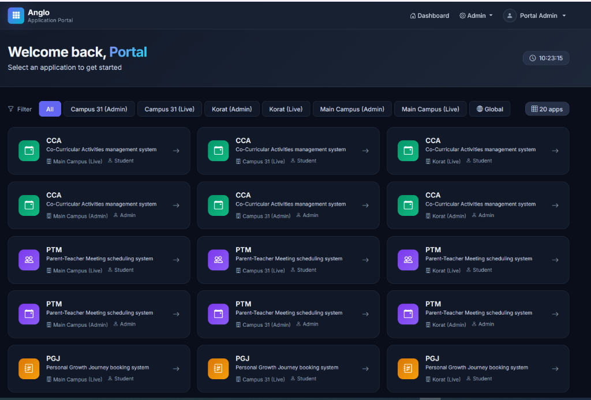
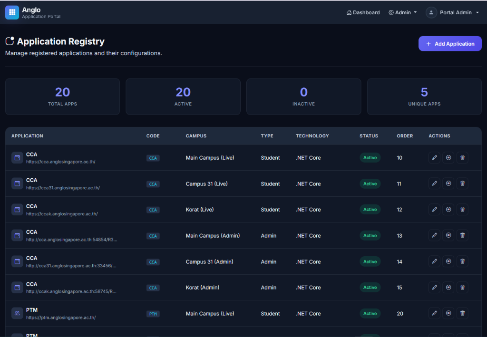
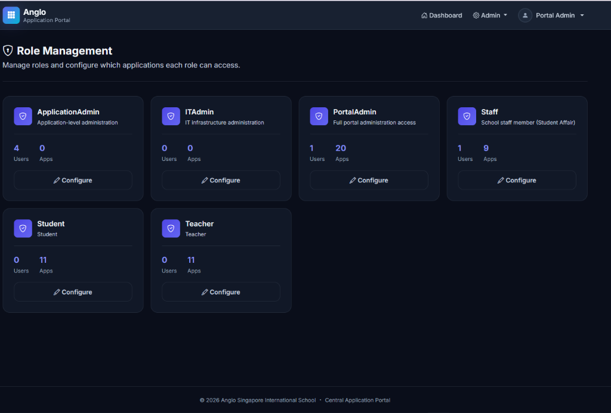
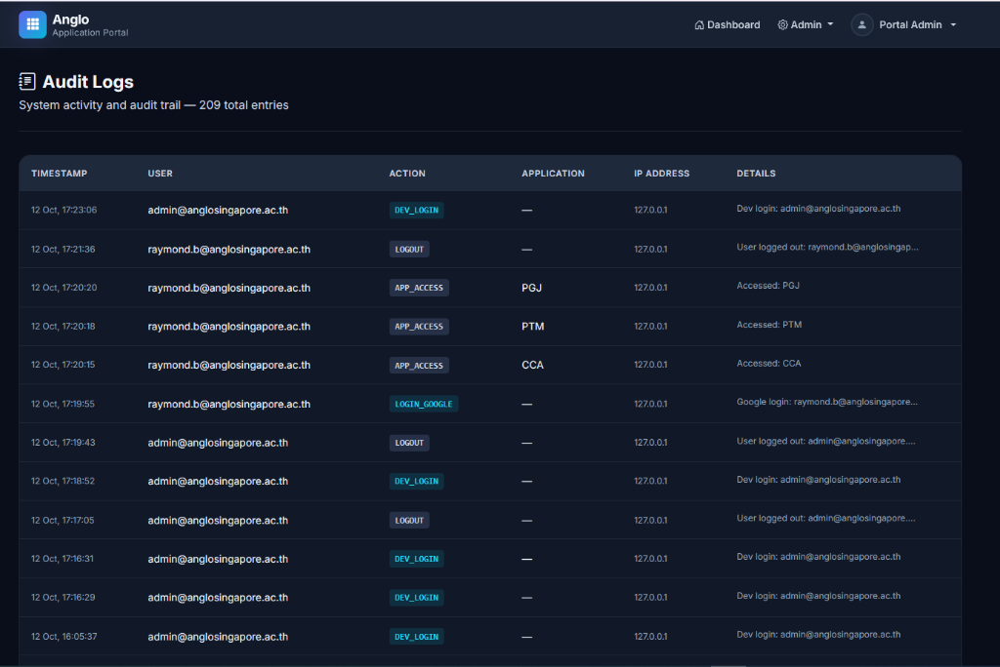

# Anglo Central Application Portal

Central entry point for Anglo Singapore International School applications.

## Stack

- **Runtime**: Node.js 18+
- **Backend**: Express.js 5
- **Database**: Microsoft SQL Server (MSSQL)
- **Templating**: EJS + express-ejs-layouts
- **Frontend**: Bootstrap 5, Vanilla JavaScript, Inter (Google Fonts)
- **Authentication**: Google OAuth 2.0 via Passport.js
- **Process Manager**: PM2 (running on Linux server)
- **Web Server / Gateway**: IIS (Reverse Proxy via ARR + URL Rewrite + Wildcard SSL)

## Screenshots

### 1. Landing Page (Login)


### 2. Dashboard (Portal Admin)


### 3. Application Registry


### 4. Role Management


### 5. Audit Logs


## Quick Start (Local Development)

```bash
# Install dependencies
npm install

# Copy environment template
cp .env.example .env

# Edit .env with your database and OAuth credentials
# (see .env.example for required variables)

# Start development server
npm run dev
```

The portal will start at `http://localhost:3000`.

In development mode, a **Dev Login** form is available on the login page,
allowing testing without Google OAuth credentials configured.

## PM2 Production Commands

```bash
# Start with PM2
npm run pm2:start

# Restart process
npm run pm2:restart

# Stop process
npm run pm2:stop

# View live PM2 logs
npm run pm2:logs
```

For complete production deployment instructions including IIS reverse proxy and environment configuration, see [DEPLOYMENT.md](DEPLOYMENT.md).

## Project Structure

```
├── server.js              ← Express entry point (trust proxy, security, routes)
├── db.js                  ← MSSQL connection pool
├── config/passport.js     ← Google OAuth strategy
├── middleware/auth.js      ← Auth & RBAC middleware
├── routes/
│   ├── auth.js            ← Login, OAuth callback, logout
│   ├── dashboard.js       ← Permission-filtered dashboard
│   └── admin/
│       ├── applications.js ← CRUD for application registry
│       ├── users.js        ← User management
│       ├── roles.js        ← Role management
│       └── auditLogs.js    ← Audit log viewer
├── views/                 ← EJS templates
├── public/                ← Static assets (CSS, JS, images)
├── utils/                 ← Audit logging, helpers
├── sql/
│   ├── schema.sql         ← Database schema (7 tables)
│   └── seed.sql           ← Initial application data
├── web.config             ← IIS Reverse Proxy (ARR) configuration
├── ecosystem.config.cjs   ← PM2 configuration
├── DEPLOYMENT.md          ← Full deployment guide (PM2 + IIS)
└── .env.example           ← Environment template
```

## Development Phases

- [x] Phase 1 — PGJ Project Review
- [x] Phase 2 — Central Portal Foundation
- [x] Phase 3 — Application Registry (DB, CRUD, seed data)
- [x] Phase 4 — Google Authentication (OAuth + dev bypass)
- [x] Phase 5 — Users, Roles & Permissions (RBAC, admin pages)
- [x] Phase 6 — Portal Dashboard (permission-filtered, tracked launches)
- [ ] Phase 7 — PGJ Pilot Integration (SSO token passing)
- [ ] Phase 8 — Remaining Applications (CCA, PTM, Booking, Meet)

## Admin Features

- **Application Registry**: Add, edit, activate/deactivate, delete applications
- **User Management**: Create users, assign roles, per-user app access
- **Role Management**: Configure role-based application access
- **Audit Logs**: Paginated audit trail of all system actions

## Access Control Logic

1. **PortalAdmin / ITAdmin** → see ALL active applications
2. **Per-user overrides** (UserApplications) → takes priority if configured
3. **Role-based access** (ApplicationRoles) → fallback
4. **Open access** → if no permissions are configured, all active apps shown
